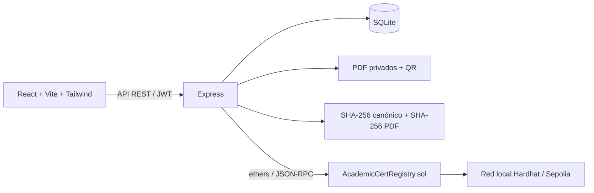

# Sistema de certificación académica mediante Blockchain en la nube

Prototipo funcional de Computación en la Nube, Carrera de Informática, Universidad Mayor de San Andrés. Todos los documentos indican **“Prototipo académico - Sin validez oficial”**. Los datos iniciales son ficticios.

## Inicio en Windows 10/11

Requisitos: Node.js **24 LTS** (mínimo 22.13), npm y VS Code. No se necesita Docker, MetaMask, Python, una cuenta de pago ni Visual Studio Build Tools. SQLite utiliza el módulo integrado de Node.js; las contraseñas usan bcryptjs, implementación compatible de bcrypt sin compilación nativa. También se probó en el Node.js 26.8.1 disponible en este equipo.

Abrir esta carpeta en VS Code y ejecutar en su terminal:

```powershell
npm install
npm run setup
npm run dev
```

Abrir **http://localhost:5173**. `setup` crea `.env`, genera secretos y contraseñas aleatorias, crea la base de datos y compila el contrato usando `solc` instalado, sin descargar compiladores adicionales. No sobreescribe `.env` ni los usuarios existentes.

Las credenciales iniciales están en **runtime/ACCESO_LOCAL.md**, generado por `setup`:

| Rol | Usuario | Contraseña |
| --- | --- | --- |
| Administrador | admin@umsa.local | ADMIN_PASSWORD de .env |
| Emisor | emisor@umsa.local | ISSUER_PASSWORD de .env |

`npm run dev` inicia y supervisa tres procesos: Hardhat (8545), Express (3001) y Vite (5173); restaura las transacciones locales y despliega el contrato automáticamente cuando es necesario. **Ctrl+C** detiene los procesos. Volver a ejecutar el mismo comando conserva estudiantes, certificados, archivos y revocaciones. No ejecutar dos instancias a la vez. Si un puerto está ocupado, cerrar la instancia anterior.

## Demostración de principio a fin

1. Entrar como emisor. En **Estudiantes**, registrar nombres, apellidos, documento único y carrera. El correo es opcional.
2. En **Emitir certificado**, seleccionar el estudiante, tipo, reconocimiento, fecha e institución. Confirmar y esperar el registro en Blockchain.
3. En el detalle se muestran los hashes SHA-256 y la transacción. Pulsar **Descargar PDF**.
4. Pulsar **Verificar**, abrir el QR o entrar en `/verificar` y pegar el código. La verificación pública no requiere sesión.
5. Subir el PDF original al portal: debe resultar válido. Modificarlo y volver a subirlo: debe resultar modificado o no coincidente.
6. Volver al detalle, pulsar **Revocar certificado**, introducir una justificación y confirmar. La consulta por código y por PDF mostrará **CERTIFICADO REVOCADO**.
7. El administrador puede crear y autorizar/desactivar emisores, ver todos los certificados, consultar la bitácora y reconciliar estados tras una interrupción.

Para emitir varios certificados: descargar la plantilla CSV desde **Emitir certificado → Emisión por lote**, usar documentos de estudiantes ya registrados y subir el archivo (máximo 30 filas). Cada fila tiene su propia transacción y resultado. Los lotes se procesan secuencialmente durante la solicitud, una simplificación de la cola en segundo plano propuesta en el informe.

## QR desde un celular

Un QR que contiene `localhost` funciona en la computadora del servidor. Para abrirlo desde el teléfono:

1. Conectar computadora y celular a la misma red Wi-Fi.
2. Obtener la dirección IPv4 de la computadora con `ipconfig`.
3. Detener el sistema y editar `.env`, reemplazando la IP del ejemplo por la real:

```dotenv
HOST=0.0.0.0
PUBLIC_URL=http://192.168.1.50:5173
```

4. Ejecutar `npm run dev`. Permitir el puerto 5173 en el firewall para la red privada, si Windows lo solicita.
5. **Emitir un nuevo certificado**: el QR incorpora la URL al generar el PDF. Los PDF anteriores no cambian.

La API y el nodo RPC siguen escuchando únicamente en loopback. El navegador del celular accede a la API mediante el proxy de Vite. La consulta se puede hacer con la cámara habitual del teléfono; no se solicita acceso a la cámara desde la aplicación.

## Arquitectura y correspondencia con el Capítulo IV

Se revisó el Capítulo IV del documento `Documento sin título (1).docx`. Se conserva su backend monolítico, separación on-chain/off-chain, control de acceso, hash canónico con salt, estados, transacciones, bitácora y verificación pública.



Adaptaciones expresamente solicitadas: PostgreSQL → SQLite, S3 → almacenamiento privado local, RPC gestionado → Hardhat local. No se implementaron ni se afirmó haber probado AWS, S3, Secrets Manager, Docker, Polygon o Sepolia. El modelo de nube del informe queda como evolución posterior.

El contrato amplía `issue(bytes32)` a **`issue(bytes32 certHash, bytes32 pdfHash)`** para anclar la integridad del PDF en la cadena. `verify` devuelve también el hash del PDF. Nunca se almacenan datos personales, documentos, salt ni motivos de revocación en Blockchain.

### Flujo de emisión y recuperación

- Copia inmutable de los datos del estudiante en el certificado; editar después al estudiante no altera documentos ya emitidos.
- UUID y salt aleatorio de 128 bits. JSON con claves ordenadas alfabéticamente, UTF-8, sin espacios. Hash SHA-256 incluye todos los datos académicos y salt.
- Crear registro `pendiente`; generar PDF con UUID en metadatos, QR y leyenda; guardarlo fuera de carpetas públicas; calcular SHA-256 de sus bytes.
- Enviar ambos hashes al contrato y esperar recibo exitoso. Solo entonces se pasa a `emitido` y se permite descargar. Un fallo deja `error`, nunca una emisión aparente.
- Las transacciones y su hash se guardan antes de enviarse. Tras una interrupción, la reconciliación comprueba el contrato y el archivo antes de recuperar el estado. El administrador puede ejecutarla desde **Certificados → Reconciliar**.
- No existe una transacción atómica entre SQLite y EVM: se conservan estados y evidencias para recuperar fallos parciales. Un archivo perdido o alterado requiere restauración desde respaldo; no se declara válido automáticamente.

### Persistencia de la red local

Hardhat reinicia su memoria al detenerlo. El lanzador reproduce **transacciones Ethereum firmadas reales**, guardadas en `runtime/chain.jsonl`, sobre una red Hardhat vacía y con el mismo chain ID. Se conservan dirección del contrato, hashes de transacción y estado de emisión/revocación. Los tiempos y hashes de bloque pueden cambiar; esto es una facilidad de desarrollo, no una red de producción. Toda consulta de validez sigue leyendo el contrato EVM.

El journal solo cubre despliegues y operaciones enviados por esta aplicación; transacciones manuales externas al backend no se respaldan. La red y las cuentas públicas de Hardhat son exclusivamente de desarrollo. Para redes externas el journal no se usa.

**Respaldar la carpeta `runtime` completa y `.env` con la aplicación detenida**. Contiene SQLite, documentos, contrato configurado, journal y credenciales iniciales. No borrar el journal conservando la base de datos ni iniciar otra red ajena en 8545.

## Organización MVC

El backend separa modelos, controladores, rutas y servicios. React representa las vistas, con cada pantalla en su propio archivo. Consulta [la estructura MVC y equivalencia de rutas](docs/ESTRUCTURA_MVC.md) para el mapa completo.

- backend/models: consultas de usuarios, estudiantes, certificados, transacciones y bitácora.
- backend/controllers y backend/routes: solicitudes HTTP, respuestas y permisos.
- backend/services: emisión, verificación, PDF, Blockchain y autenticación.
- backend/database: conexión, semilla y migración SQLite existente.
- frontend/src/views: pantallas; components: elementos compartidos; layouts: estructura del panel.
- frontend/src/services, context y hooks: API, sesión y carga de datos.
- scripts: preparación, arranque y despliegue. Los informes terminados se conservan en output/documentos.
- docs/referencias: informe original; runtime: datos privados existentes.

La configuración y las dependencias permanecen en la raíz. SQLite mantiene las mismas tablas, relaciones y restricciones, sin cambios de esquema ni de datos. Los documentos Word previos describen la organización anterior; ESTRUCTURA_MVC.md indica los archivos equivalentes.

## API principal

Todos los endpoints tienen prefijo `/api`.

| Método y ruta | Acceso |
| --- | --- |
| POST /auth/login | Público, limitado por intentos |
| GET /health | Público |
| GET /verify/:codigo | Público |
| POST /verify/file | Público, PDF hasta 10 MB |
| GET /me, GET /dashboard | Autenticado |
| GET, POST /students; PUT /students/:id | Autenticado |
| GET, POST /certificates | Certificados propios o todos si ADMIN |
| POST /certificates/batch | Emisión por CSV |
| GET /certificates/:id | Propietario o ADMIN |
| GET /certificates/:id/pdf | Propietario o ADMIN; comprueba integridad |
| POST /certificates/:id/revoke | Propietario o ADMIN |
| GET, POST /users; PATCH /users/:id | ADMIN |
| GET /audit; POST /reconcile | ADMIN |

El portal expone nombre del titular, tipo, reconocimiento, institución, carrera y fecha; nunca documento de identidad, correo, salt, ruta privada ni usuarios. La carga de PDF lee el UUID de sus metadatos, compara el archivo completo con SHA-256 y consulta la vigencia en cadena. Un QR o código demuestra el estado del registro; para comprobar además el archivo concreto debe utilizarse la carga del PDF.

## Pruebas y compilación

```powershell
npm test
npm run build
```

Las pruebas del contrato usan una EVM Hardhat en memoria. Las pruebas HTTP levantan una red real aislada en **18545**, una API en **13001** y una carpeta aleatoria en `test-runtime`, sin modificar los datos de la demostración. Comprueban login, permisos, duplicados, emisión, recibo de transacción, ambos hashes on-chain, PDF privado, lectura del QR incrustado, verificación pública, archivo modificado, revocación, estadísticas, auditoría, caída de RPC y reinicio completo con restauración.

Para guardar una evidencia de ejecución en PowerShell:

```powershell
npm test 2>&1 | Tee-Object -FilePath docs/pruebas-ejecucion.txt
```

`npm run build` crea `dist`. Para el uso local solicitado se utiliza `npm run dev`; `dist` por sí solo necesita una API y un proxy `/api`.

## Configuración y Sepolia (opcional, no ejecutado)

`.env.example` describe todas las variables. JWT de una hora, bcrypt con costo 12, usuarios activos comprobados en cada petición, Helmet, límite de peticiones, validación Zod y PDFs fuera de `public`.

Para migrar a Sepolia con fondos **de prueba**: detener el sistema, respaldar datos y configurar un directorio nuevo, RPC de Sepolia, `CHAIN_ID=11155111`, `PRIVATE_KEY` para el emisor y `ADMIN_PRIVATE_KEY` para el despliegue. Dejar `CONTRACT_ADDRESS` vacío para desplegar, o asignar una dirección compatible previamente desplegada. Usar wallets distintas para administración y emisión.

```dotenv
DATA_DIR=./runtime-sepolia
RPC_URL=https://TU-PROVEEDOR-SEPOLIA
CHAIN_ID=11155111
PRIVATE_KEY=CLAVE_DE_PRUEBAS_DEL_EMISOR
ADMIN_PRIVATE_KEY=CLAVE_DE_PRUEBAS_DEL_ADMINISTRADOR
CONTRACT_ADDRESS=
```

```powershell
npm run deploy
npm run dev
```

En esa red no se inicia Hardhat ni se reproducen transacciones. Después del despliegue, quitar `ADMIN_PRIVATE_KEY` del backend y conservarla fuera del servidor; el servicio usa únicamente la wallet emisora. Las autorizaciones de usuarios de la web son distintas de `ISSUER_ROLE`: todos los emisores web autorizados operan mediante la wallet institucional del backend, como establece el informe.

## Límites del prototipo

- Ejecución local por HTTP; despliegue público requeriría HTTPS, gestión de secretos y almacenamiento de producción.
- Revocación definitiva, sin eliminación del registro. No se usan firmas institucionales reales.
- Autenticación JWT con token en `sessionStorage`; cerrar sesión borra la sesión del navegador. Desactivar al usuario invalida su acceso inmediatamente.
- Sin promesa de atomicidad distribuida, carga masiva en segundo plano, auditoría externa de seguridad ni SLA.
- Herramientas de desarrollo Hardhat 2/Tailwind 3 conservan avisos transitivos de `npm audit`; se actualizaron las dependencias de la aplicación y Vite/PostCSS. Consultar `npm audit` antes de un despliegue público. La red y la aplicación escuchan por defecto en loopback.

Documentación de referencia: [Hardhat Network](https://v2.hardhat.org/hardhat-network/docs/overview) y [SQLite integrado de Node.js](https://nodejs.org/download/release/latest-v24.x/docs/api/sqlite.html).
# Sistema-Blochaing-para-Certificados
